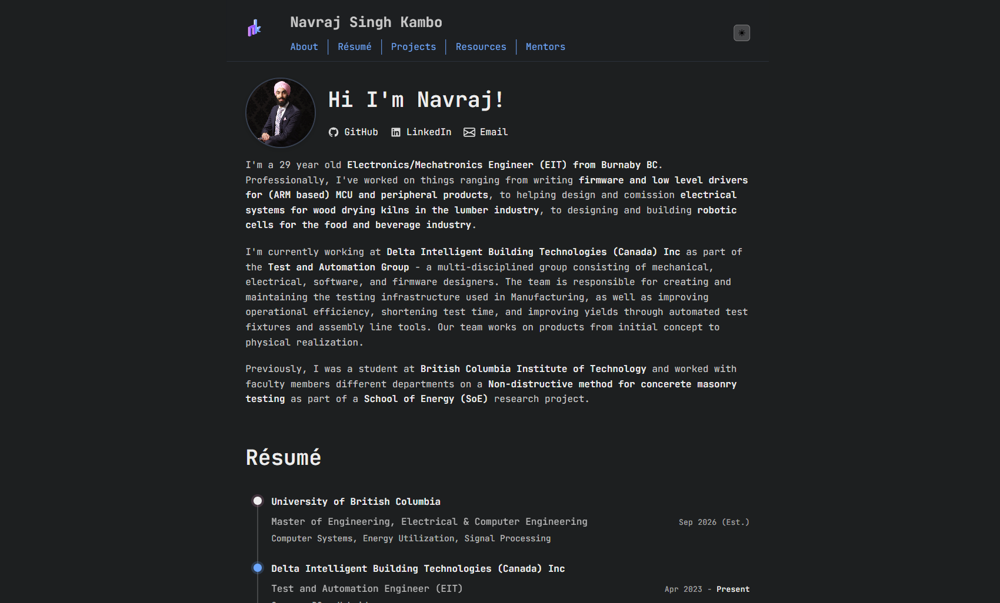

# Portfolio

My personal portfolio website showcasing my work experience in Electronics, Robotics, and Automation.

**Live site:** [navrajkambo.github.io](https://navrajkambo.github.io)

## Preview




## Tech Stack

- Vanilla HTML, CSS, JavaScript
- Markdown content
- GitHub Pages hosting

## Development

```bash
# Serve locally
python -m http.server 8000 -d docs/

# Hard Refresh
CTRL + F5
```

## Structure

- `docs/index.html` - Main page
- `docs/*.md` - Content (about, projects, resume)
- `docs/styles.css` - Styling
- `docs/script.js` - Functionality

Inspired by [astro-theme-cactus](https://astro-cactus.chriswilliams.dev/) :)
